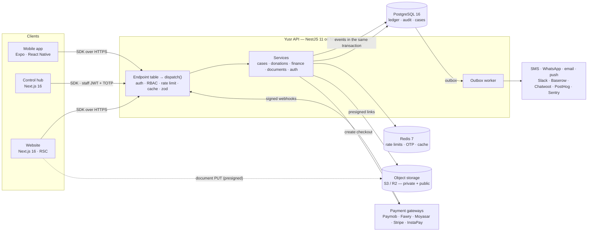
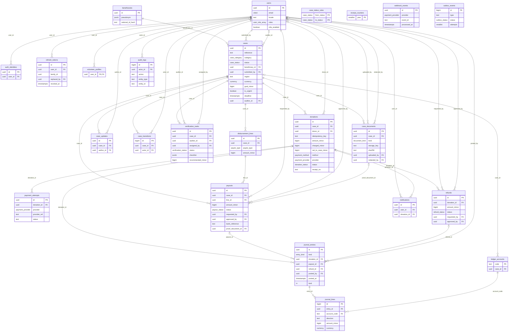
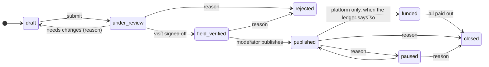
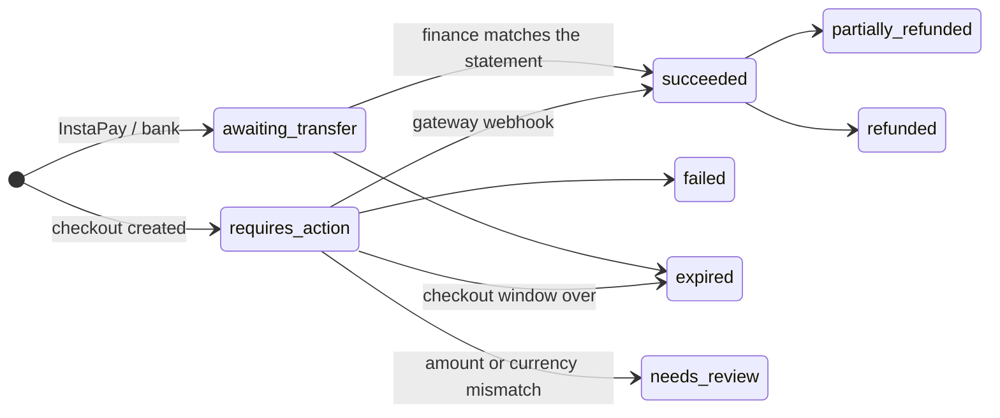

# Architecture

Yusr (يُسر) connects donors with verified people in need — medical cases, debt relief, orphans'
care, education and urgent relief — and pays hospitals, creditors and schools directly, with a
receipt and proof of payment for every pound. This document is the map: what runs where, how a
request travels, what the data looks like and which rules the system refuses to break.

**Contents** · [System](#system) · [Monorepo](#monorepo) · [The API](#the-api) · [Data model](#data-model) ·
[Lifecycles](#lifecycles) · [Clients](#clients) · [Language and theme](#language-and-theme) ·
[Background work](#background-work) · [Configuration](#configuration) · [Testing](#testing)

Related: [Payments](PAYMENTS.md) · [Security](SECURITY.md) · [Operations](OPERATIONS.md) ·
[Brand](BRAND.md) · [Mobile](MOBILE.md) · [Roadmap](ROADMAP.md)

## Principles

1. **Money is accounted, not counted.** Every movement is a balanced double-entry journal entry;
   a case's "raised" figure is a ledger balance, never a counter that can drift.
2. **Trust is enforced below the application.** The rules that matter (balanced journals,
   append-only audit, four-eyes payouts, allowed case transitions) are PostgreSQL constraints and
   triggers, so a bug in a service cannot break them.
3. **One contract, many clients.** A single endpoint table drives the HTTP API, its OpenAPI 3.1
   document, request validation and rate limits; the typed `@yusr/sdk` is the only way the web,
   control hub and mobile app talk to it.
4. **Arabic first, not Arabic too.** Right-to-left layouts, Arabic plural rules and Arabic-Indic
   digits are the default path; English is a full second language.
5. **Dignity by design.** No beneficiary photos (illustrated covers instead), pseudonyms on public
   pages, redacted documents, national IDs encrypted and matched only by keyed hash.

## System



The browser never calls the API directly from the website: pages render on the server with the
SDK, and forms post to Next.js server actions. The only direct browser → cloud traffic is the
upload of case documents to object storage through ten-minute presigned links.

## Monorepo

pnpm workspaces + Turborepo. Shared packages are compiled with tsup (ESM + CJS + types); tests,
tools and the API in development read them from source through the `@yusr/source` export
condition, so nothing needs building between an edit and a test run.

```text
yusr/
├─ apps/
│  ├─ web/          Donor website — landing, catalog, case pages + checkout, receipts, case submission
│  ├─ admin/        Control hub — overview, case pipeline, field verification, finance, people, audit
│  ├─ mobile/       iOS + Android app (Expo Router) — home, explore, my giving, profile, native checkout
│  └─ prototype/    Clickable bilingual prototype of everything, built into one HTML file
├─ packages/
│  ├─ core/         Domain: types, money, progress, lifecycle, RBAC, payments routing, ledger, zod schemas
│  ├─ i18n/         Arabic + English dictionaries, ICU-style plurals, number/money/date formatting
│  ├─ theme/        Design tokens → CSS variables, Tailwind v4 theme, React Native theme; logo + pattern
│  ├─ ui/           Shared React components (shadcn-style, Tailwind v4): CaseCard, DonationProgress, …
│  ├─ sdk/          Typed API client (+ an in-memory backend with the same contract, for demos and tests)
│  ├─ api/          NestJS API, PostgreSQL schema + migrations, gateways, outbox worker
│  └─ config/       Shared tsconfig presets
├─ infra/           docker-compose (PostgreSQL, Redis, MinIO) and Dockerfiles
├─ docs/            This documentation
└─ .github/         CI
```

| Package | Depends on | Notes |
|---|---|---|
| `@yusr/core` | zod | No I/O. Everything else builds on it. |
| `@yusr/i18n` | core | `textFor(locale)` on the server, a provider on clients. |
| `@yusr/theme` | — | One TypeScript source compiled to `tokens.css`, `tailwind.css`, native tokens and SVG assets. |
| `@yusr/ui` | core, i18n, theme | Server-compatible; only the live countdown is a client component. |
| `@yusr/sdk` | core | `createHttpClient`, `createHttpAdminClient`, `createHttpAuthClient`, `createMockBackend`. |
| `@yusr/api` | core, i18n, sdk (tests) | Nest controllers are generated from the endpoint table. |

## The API

Every route is one object in `packages/api/src/http/endpoints/*`:

```ts
endpoint({
  id: 'donations.create',
  method: 'POST', path: '/donations', version: '1',
  access: 'public',                       // public · user · staff
  body: createDonationSchema,             // zod: validated, and exported to OpenAPI
  headers: [{ name: 'Idempotency-Key', required: true }],
  rateLimit: { name: 'donations:create', limit: 30, windowSeconds: 600, by: 'ip' },
  handle: ({ services, ctx, body, request }) => services.donations.create(body, { ...ctx, idempotencyKey: … }),
});
```

From that table the API derives, in one place:

- **`dispatch()`** — the request pipeline: authenticate (JWT) → access level and permission
  (staff permissions also require a completed second factor) → Redis rate limit → guest GET cache
  → zod validation of body and query → handler → `application/problem+json` errors with stable
  codes (`VALIDATION_FAILED`, `IDEMPOTENCY_CONFLICT`, `FORBIDDEN_TRANSITION`, …).
- **NestJS controllers**, one per tag, generated with Nest's decorators — Nest provides the
  server, lifecycle and DI; it does not own the routing rules.
- **`GET /v1/openapi.json`** — OpenAPI 3.1 built from the same schemas.
- **A plain `node:http` host** used by the end-to-end tests.

55 routes in 10 groups: System, Catalog, Donations, Submissions, Auth, Me, Payments (webhooks) and
Operations · Cases / Finance / People. The prototype's architecture page lists them all, generated
from the table at build time.

## Data model

PostgreSQL 16, hand-written SQL migrations (`packages/api/src/db/migrations/`, starting with
`0000_init.sql`: 24 tables, 2 views, 17 enums, 9 triggers), applied in order by
`src/db/migrate.ts` (`pnpm db:migrate`), which records each file with a checksum in
`yusr_migrations`. A schema change is a new numbered file mirrored in `schema.ts`. Amounts are
integer minor units (`bigint`) with an explicit currency; timestamps are `timestamptz`; public ids
are UUIDv7.



The generated diagram shows keys and the columns that carry business meaning; the migration has
every column, comment and constraint.

### Invariants the database enforces

| Rule | How |
|---|---|
| Every journal entry balances, per currency | Deferred constraint trigger `journal_lines_invariants`, checked at COMMIT |
| Ledger and audit log are append-only | `forbid_mutation()` triggers on UPDATE / DELETE / TRUNCATE |
| A case fund never goes below zero | Checked in the same trigger for `liability:case:*` accounts |
| Four eyes on money out | `payouts_four_eyes`, `refunds_four_eyes`: approver ≠ requester |
| Cases move only along allowed edges; only the platform sets `funded` | `cases_status_guard` against `case_status_rules` |
| Public cases are verified | `cases_public_verified`: published/funded ⇒ `verified_at` |
| A webhook is applied once; one journal entry per donation / payout | `webhook_events_once`, partial unique indexes |
| One open field visit per case | `verification_one_open_task` partial unique index |

The services check the same rules first (with friendly errors); the database is the backstop.

## Lifecycles

### Case



Each edge belongs to a permission (`packages/core/src/lifecycle.ts`); the control hub only offers
the edges the signed-in role holds, and the API re-checks them.

### Donation



Only a verified webhook (or a finance officer's reconciliation of a transfer) marks a donation
succeeded. Return URLs are for people; they never change money state.

## Clients

**Website (`apps/web`)** — Next.js 16 App Router, React Server Components, Tailwind v4.
Locale-prefixed routes (`/ar`, `/en`; the proxy picks the language from a cookie or
`Accept-Language`). Catalog reads go through Next's data cache for 20 seconds; anything personal
is `no-store`. The donate form and the case submission form post to server actions and work
before JavaScript loads. A per-request nonce CSP allows no third-party script; the only outbound
browser traffic is to the gateway (form action) and to object storage (document upload).

**Control hub (`apps/admin`)** — staff only. Sign-in is phone OTP **and** an authenticator code;
sessions are an httpOnly access cookie plus a rotating refresh cookie, refreshed in the Next.js
proxy only (prefetches skip it, so a refresh token is never raced). Navigation shows the sections
a role can use: the case pipeline with role-aware transitions, field verification (assign an
auditor, checklist, sign-off with the verified goal), finance (transfer reconciliation, maker-checker
payouts, ledger balance check), donors / volunteers / team, and the audit trail.

**Mobile (`apps/mobile`)** — Expo SDK 54, Expo Router, React Native 0.81 with the new
architecture. Same SDK, dictionaries, tokens and icon set as the web. Arabic switches the whole
layout to RTL (one reload, as React Native requires). Checkout opens hosted gateways in an auth
session that closes on `yusr://receipt`, confirms Stripe in the native Payment Sheet, and shows
Fawry / InstaPay references in the app. See [MOBILE.md](MOBILE.md).

**Prototype (`apps/prototype`)** — every surface above as one self-contained, clickable page,
running the real shared packages against the SDK's in-memory backend.

## Language and theme

`@yusr/i18n` holds both dictionaries (typed keys — a missing key is a compile error), Arabic
plural categories (zero / one / two / few / many / other), and formatters for money, percentages,
dates and relative times with Arabic-Indic digits in Arabic. Components get a `{ t, f, l }`
bundle (`l` picks the locale's side of a `{ ar, en }` value).

`@yusr/theme` is the single source of the brand: semantic colours for light and dark, category
tones, radii, type scale, motion, the logo geometry and the «روضة العطاء» pattern. It emits
`tokens.css` (CSS variables), `tailwind.css` (a Tailwind v4 `@theme inline` block mapping those
variables to utilities such as `bg-primary`, `rounded-card`), a React Native theme, and SVG
assets. Swapping the palette is one `createTheme()` call; see [BRAND.md](BRAND.md).

## Background work

State changes that must reach the outside world (a donation succeeded, a case was funded, a
visit was assigned) write an `outbox_events` row **in the same transaction**. The worker
(`pnpm --filter @yusr/api worker`) claims events with `FOR UPDATE SKIP LOCKED`, delivers them
with retries and backoff, and fans out:

| Event | Goes to |
|---|---|
| `donation.succeeded` | Receipt by email / SMS / WhatsApp, push to the donor's devices, analytics |
| `donation.failed`, `donation.expired` | A gentle "your payment didn't complete" with a link to try again |
| `case.funded` | Donors of the case; finance channel in Slack |
| `payout.paid` | Donors of the case (proof of payment), case page transparency |
| `case.submitted` | Slack `#field-ops`, a row in the Baserow visits table |
| `verification.assigned` | The auditor (SMS / WhatsApp), Baserow |
| `finance.review_needed` | Finance in Slack (amount or currency mismatch from a gateway) |
| `refund.processed` | The donor |
| other `case.*` transitions | Product analytics only |

## Configuration

Each app has an `.env.example` with every variable explained. The API validates its environment at
start-up (`packages/api/src/config/env.ts`) and refuses to start in production with development
defaults (memory storage, simulated payments, missing secrets).

| App | Key settings |
|---|---|
| API | `DATABASE_URL`, `REDIS_URL`, `JWT_SECRET`, `OTP_PEPPER`, `NATIONAL_ID_PEPPER`, `DATA_KEY_BASE64`, gateway keys, `S3_*`, messaging and ops tokens |
| Web | `YUSR_API_URL`, `NEXT_PUBLIC_SITE_URL`, `UPLOAD_ORIGIN`, `NEXT_PUBLIC_SHOW_SUPERVISION`, `NEXT_PUBLIC_MOSS_REGISTRATION_NUMBER` |
| Admin | `YUSR_API_URL` |
| Mobile | `EXPO_PUBLIC_API_URL`, `EXPO_PUBLIC_WEB_URL` (and `app.json` → `extra`) |

`YUSR_STORAGE=memory` runs the API with no database or Redis (seeded demo data, simulated
gateways) — the fastest way to click through everything locally.

## Testing

| Suite | What it proves |
|---|---|
| `packages/core` | Money rounding, honest progress, fees and gross-up, ledger postings balance, lifecycle and RBAC rules, schemas |
| `packages/i18n` | Both dictionaries have the same keys and placeholders; plurals and digits |
| `packages/theme` | Contrast (WCAG AA) of every token pair, logo geometry, pattern tiling |
| `packages/sdk` | The in-memory backend honours the API contract |
| `packages/ui` | Server rendering of the case card, progress and countdown in both languages |
| `packages/api` | Services, gateway signatures and parsers, **end-to-end over real HTTP with the SDK**, and **SQL tests on PostgreSQL 16** that try to break the invariants above |

`node apps/prototype/scripts/verify.mjs` runs them all and records the result for the prototype's
architecture page.
