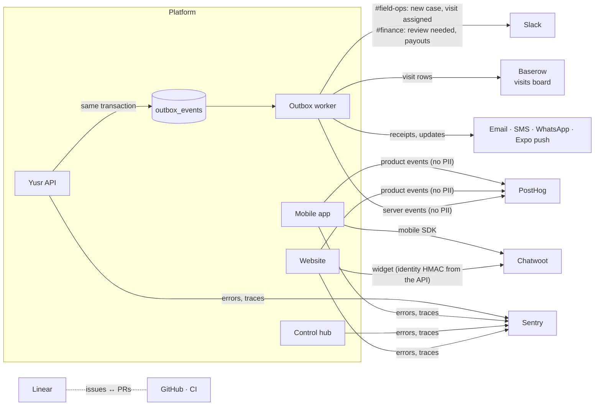
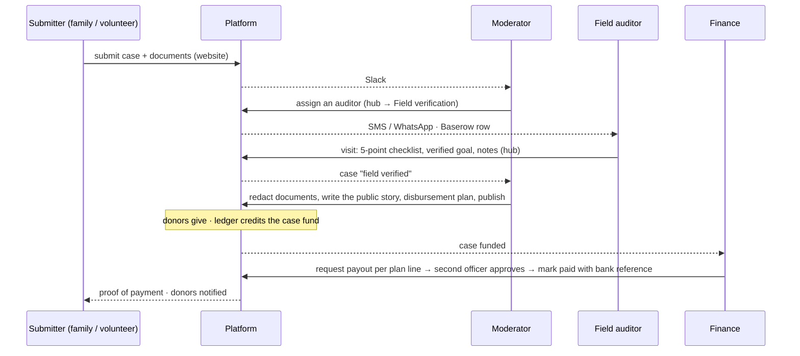

# Operations

The tools the team works in, how they connect to the platform, and the routines that keep cases
moving and money reconciled. The platform stays the record of truth (cases, visits, money);
the tools around it are where people coordinate.

## The stack

| Need | Recommended | Alternatives | Why this one |
|---|---|---|---|
| Product and sprint tracking | **Linear** | ClickUp, Notion | Fast triage, cycles, GitHub integration (PRs close issues), a public roadmap view |
| Team chat and alerts | **Slack** | Lark | Incoming webhooks per channel, mature mobile apps for field staff |
| Field-visit planning | **Baserow** (self-hosted) | Airtable | Open source, can run in-country, spreadsheet UX volunteers already know |
| Donor and beneficiary support | **Chatwoot** (self-hosted) | Crisp | Web widget + mobile SDK + WhatsApp inbox in one place; HMAC identity validation |
| Product analytics | **PostHog** (EU cloud) | — | Funnels for the donate flow without personal data, feature flags for gradual launches |
| Errors and performance | **Sentry** | — | One project per app (web, hub, mobile, API) with releases tied to the git SHA |

## How they connect

- **Slack** receives only what someone must act on: `#field-ops` (new submissions, visits
  assigned), `#finance` (gateway amount mismatches, payouts approved and paid). Configure
  `SLACK_FIELD_OPS_WEBHOOK` and `SLACK_FINANCE_WEBHOOK`.
- **Baserow** gets a row per assigned visit (case reference, governorate, auditor, visit time, a
  link to the case in the hub) — `BASEROW_URL`, `BASEROW_TOKEN`, `BASEROW_VISITS_TABLE_ID`.
  Coordinators plan routes there; the checklist and the sign-off happen in the hub.
- **Chatwoot** trusts who is chatting: for signed-in people the API returns an identifier hash
  (`CHATWOOT_HMAC_TOKEN`), so agents see the right donor's history.
- **PostHog** events carry pseudonymous ids, categories and amount bands — never names, phones or
  emails (`POSTHOG_KEY`, `POSTHOG_HOST`).
- **Sentry** runs in every app with `sendDefaultPii` off; releases are tagged with `YUSR_RELEASE`.
- Every integration is optional: without its settings the worker simply skips it.

## The field-operations loop

Targets: first contact within 48 hours of a submission, a visit within 5 working days,
publication within 24 hours of sign-off, payouts within 3 working days of funding.

## Routines

**Daily — finance**
1. Hub → Finance → *Transfers awaiting confirmation*: match each InstaPay line on the bank
   statement (reference = receipt number) and confirm with the bank reference and the amount received.
2. Review anything in *needs review* (gateway mismatches) — never "fix" amounts by hand; refund
   or ask the gateway.
3. Approve payouts requested by the other officer; mark paid ones with the bank reference and
   attach the payee's receipt.

**Daily — moderation**: new submissions triaged (reject with a reason, or assign a visit);
funded cases checked for a complete disbursement plan.

**Weekly**: ledger check (the hub shows whether the journal balances and case funds match the
summary view); gateway settlement reports matched against `asset:clearing:*`; a sample of
published cases re-checked by a second auditor.

**Monthly**: access review (who holds which role, MFA on for everyone), secrets rotation where
due, restore test of the latest backup.

## Environments and deploys

| Environment | Data | Payments |
|---|---|---|
| Local | `docker compose` (PostgreSQL, Redis, MinIO) or `YUSR_STORAGE=memory` | Simulated gateway |
| Staging | Seeded, anonymised | Provider sandboxes (Paymob, Fawry staging, Stripe test, Moyasar test) |
| Production | Real | Live keys, webhooks pointed at `https://api.<domain>/v1/webhooks/<provider>` |

CI (`.github/workflows/ci.yml`) checks formatting and lint, builds, typechecks and tests every
package, runs the SQL suites against PostgreSQL 16, applies the migrations to a fresh database,
bundles the mobile app for Android and iOS, and builds the prototype. Deploys run migrations first
(`node dist/db/migrate.js` in the API image — a release command on Railway/Render/Fly), then the API
and worker, then the web apps. The migration runner takes an advisory lock, applies each new SQL file
in its own transaction and refuses an applied file that was edited. The API's `/health/ready`
checks the database and Redis before traffic is sent to a new instance.

## Incident playbook (short)

- **Payments not confirming**: check the provider status page and the webhook deliveries in its
  dashboard; `webhook_events` shows what arrived and when. Donations stay `requires_action` and
  expire safely; nothing is credited without a verified webhook.
- **Suspected account compromise (staff)**: change the person's roles (`PUT /v1/admin/team/:id/roles`) — the next
  access token (≤ 15 minutes) carries the new roles; revoke their refresh tokens in the database
  for an immediate cut-off; review the audit log for the user's actions.
- **Data request from a beneficiary**: locate by case reference; beneficiaries' national IDs are
  retrievable only by an auditor through the API, and every access is audited.
