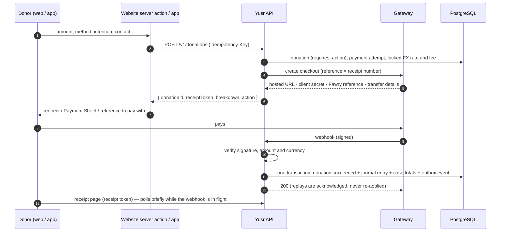
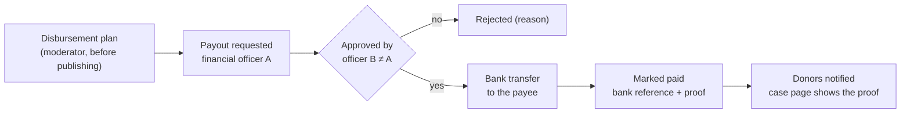

# Payments

How a donation becomes money in a case fund, and how that money reaches a hospital, a creditor or
a school — with every step recorded in a double-entry ledger that the database itself keeps balanced.

## Gateways and routing

One table decides which gateway processes a payment method in a currency
(`packages/core/src/payments.ts`). Change routing there — controllers never branch on providers.

| Method | EGP | SAR | USD | Checkout | Settles |
|---|---|---|---|---|---|
| Card (Visa / Mastercard / Meeza) | Paymob | Moyasar | Stripe | Hosted page | Immediately |
| Apple Pay | Paymob | Moyasar | Stripe | Hosted page (web) · Payment Sheet (app, USD) | Immediately |
| mada | — | Moyasar | — | Hosted page | Immediately |
| Vodafone Cash | Paymob | — | — | Wallet page + OTP | Immediately |
| Fawry | Fawry | — | — | Reference number, pay at an outlet | Within 72 h |
| InstaPay | InstaPay | — | — | Transfer to our IPA with the receipt number | Finance confirms (48 h window) |

Card data never touches our servers: every card flow is the gateway's hosted page or the native
Stripe sheet (PCI DSS SAQ-A scope).

**Stripe on the website vs. the app.** The gateway picks the checkout from the return URL: an
`https://` return (the website) creates a hosted **Stripe Checkout session**; the app's
`yusr://` return creates a **PaymentIntent** that the app confirms in Stripe's Payment Sheet.
Both carry our reference in the PaymentIntent's metadata, so one set of `payment_intent.*`
webhooks settles either, and refunds always use the PaymentIntent id.

## The checkout, step by step

- **Idempotency.** `POST /v1/donations` requires an `Idempotency-Key` (one per attempt). The API
  stores the key with a hash of the request: the same key and body return the same donation and
  checkout step (a double click, a retry after a dropped connection); the same key with a
  different body is refused with `IDEMPOTENCY_CONFLICT`. The website mints the key on the server
  for each form render; the app mints one per distinct attempt.
- **The return URL is for people.** Landing on the receipt proves nothing — the webhook does.
  The receipt page shows "still confirming" and re-reads the status for a couple of minutes.
- **Amounts are locked at creation**: the fee estimate, whether the donor covers it, and the FX
  rate for cross-currency gifts (a USD gift to an EGP case credits the case in EGP at the locked rate).
  When the rates feed has not refreshed within its allowed age (36 hours by default), cross-currency
  gifts are refused (`METHOD_NOT_AVAILABLE`) until it does; gifts in the case's currency go on.
- **Mismatches are held, not guessed.** If the gateway reports a different amount or currency,
  the donation goes to `needs_review` and finance is alerted in Slack.
- **Expiry.** Open checkouts expire (30 minutes for cards and wallets, 72 hours for Fawry, 48 hours
  for InstaPay); the worker marks them `expired` and tells the donor how to try again.

### Webhook verification

| Gateway | Verification |
|---|---|
| Paymob | HMAC-SHA512 over the documented transaction fields, `hmac` query parameter; then the transaction is read back from Paymob (below) |
| Fawry | SHA-256 message signature over the notification fields and the secure key |
| Moyasar | Shared `secret_token` in the payload (constant-time comparison) |
| Stripe | `Stripe-Signature`: HMAC-SHA256 over `timestamp.body`, any `v1`, 5-minute tolerance |
| InstaPay | No webhook: finance reconciles the bank statement (below) |
| Simulated (development) | HMAC with a local secret, so the whole asynchronous flow runs without sandbox keys |

Every comparison is constant-time. Raw request bytes are kept for verification (the API mounts a
raw body parser on `/v1/webhooks`). Each `(provider, event_id)` is stored once; a replay is
acknowledged and ignored.

Paymob's HMAC joins the field values without separators, so a signature does not pin where one
field ends (numbers can slide from `created_at` into `amount_cents`), and the merchant reference is
not signed. A verified Paymob callback is therefore only a hint: its id, order, integration (one of
ours) and timestamp are checked, the transaction is fetched from
`GET /api/acceptance/transactions/{id}` with the secret key, and the amount, currency, status flags
and order come from that answer. The donation is the one whose checkout created that Paymob order
(stored on the payment attempt), never the one named by `merchant_order_id`. The event id includes
the status flags, so a pending transaction that later succeeds is processed again.

## The ledger

Accounts (`packages/core/src/ledger.ts`):

| Account | Type | Meaning |
|---|---|---|
| `asset:clearing:<provider>` | asset | What a gateway owes us until it settles |
| `asset:bank:operating` | asset | The operating bank account |
| `liability:case:<caseId>` | liability | Money held for a case until it is paid out |
| `expense:gateway_fees` | expense | Processing fees |
| `revenue:fee_recovery` | revenue | Fees the donor chose to cover |
| `equity:fx:<currency>` | equity | FX position for cross-currency gifts |

Postings (debits = credits, per currency — checked in code and again by a database trigger):

| Event | Debit | Credit |
|---|---|---|
| Donation succeeded | clearing (charged − fee), gateway fees (fee) | case fund (net to case), fee recovery (covered fee) — with FX position lines when currencies differ |
| Gateway settles to the bank | bank | clearing |
| Payout to a payee | case fund | bank |
| Refund | case fund, fee recovery (the part that was recovered) | clearing (the charge refunded) — the original processing fee stays expensed |

A case's raised amount and its "remaining" figure are read from these balances (`case_fund_summary`
view); a case fund can never go negative.

## Money out: payouts and refunds

- A payout pays **one line of the case's disbursement plan** (a hospital invoice, a court-ordered
  debt, a school's fees) directly to the payee — never cash to the beneficiary. The plan is fixed
  once the case is published.
- **Maker-checker.** The officer who requests a payout can neither approve it nor mark it paid —
  enforced by the API and by a `CHECK` constraint. The transfer goes to the bank account on the plan
  line; a request cannot name another account. Refunds follow the same rule.
- **A refund is sent once.** Approving moves it to `sending` under a row lock before the provider is
  called (most providers ignore idempotency keys), the provider's reference is saved before the
  ledger entry, and the database posts one refund entry per refund. A refund left in `sending`
  without a reference (the provider call failed or timed out) is not sent again: check it with the
  provider first. Approval also re-checks that the donation is still paid (not charged back or
  under review).
- **Reconciliation of InstaPay transfers.** Finance matches the statement line and confirms the
  donation with the bank reference and the amount received; the amount must equal what the donor
  was asked to send, or the API refuses. Only InstaPay donations that are awaiting their transfer
  (or expired before it arrived) can be confirmed, and each bank reference matches one donation.
- Everything above lands in the append-only audit log with the actor, before/after values and
  the request id.

## Adding a gateway

1. Implement `PaymentGateway` (`createCheckout`, `parseWebhook`, `refund`) in
   `packages/api/src/payments/gateways/` — REST over `fetch`, no SDK needed.
2. Add its methods to `PAYMENT_ROUTES` and its fee rules to `DEFAULT_FEES` in `@yusr/core`.
3. Add its configuration to `config/env.ts` and `.env.example`; register it in `app.services.ts`.
4. Add signature and parsing tests to `packages/api/test/gateways.test.ts` with the provider's
   documented sample payloads.
